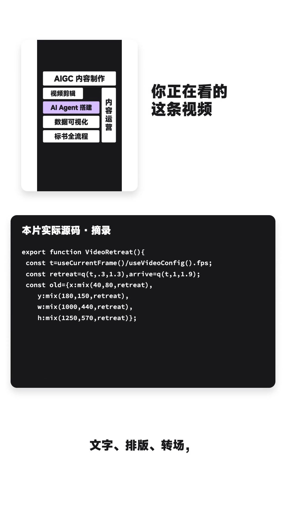
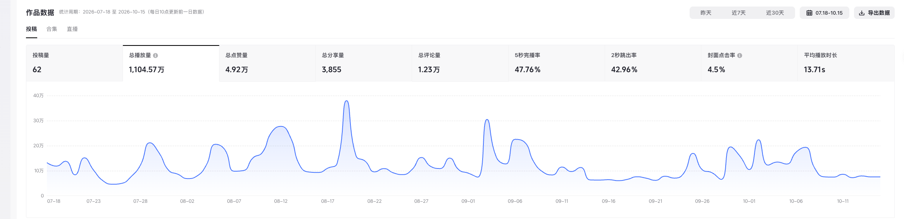
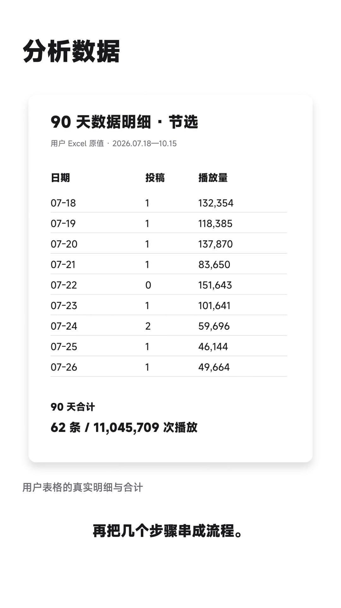

# 简历之外，我能把什么事做成？

我正在找工作。

写简历的时候，我常常遇到一个问题：做过的事情不少，真正放进一两页纸里，最后往往只剩几个岗位、几段经历，以及一串“熟练掌握”。看的人扫几眼，很难知道这些词到底意味着什么。

于是，我做了一条求职自荐视频。把 AIGC 作品、内容数据、工作方法和实际制作过程放在一起，先交出一个可以点开看的东西。

视频只有两分多钟，有些事情来不及展开。这篇文章，就当是视频之外的一份补充：我能做什么，习惯怎样做事，以及这些能力放进具体工作里，可以怎样配合。

## 先把作品拿出来

我做过几种不同风格的 AI 视频：校园夕阳里的情绪 MV、草地与花朵组成的音乐片段、古风人物演唱、火柴人寓言，还有剪纸拼贴的历史叙事。

看起来题材不一样，制作时却有一些共同的问题：这段内容到底要表达什么？观众先看到什么，再看到什么？一段镜头为什么要放在这里？人物、场景和声音能不能接得上？

AI 绘图、人物设计、场景生成、视频生成和镜头设计，我都在实际作品里尝试过，也能够把它们组合起来完成短片。对我来说，拿到一张好看的图只是开始。接下来还要决定它属于哪一镜、停留多久、怎样接到下一镜，最后能不能组成一条说得清楚的视频。

比如情绪 MV，我会更在意人物近景、环境远景和细节之间的搭配。火柴人故事则需要把观点放进事件：角色想要什么，为什么做出一个选择，选择之后发生了什么。剪纸风格又要照顾画面层次、人物和地图之间的关系，不能只把素材贴到同一个背景上。

这些作品还有可以继续打磨的地方。但它们是已经做出来的东西，也能让人比较具体地判断：我现在能做到哪一步，适合从什么样的任务开始合作。

想看完整片段，可以继续看博客里那篇[《我用 AI 做视频：从一个想法，到一支短片》](2026-09-26-aigc-video-creation.html)，以及[剪纸视频的制作记录](2026-07-16-ai-work-journal.html)。

## 视频剪辑，我更愿意把重复操作整理成流程

常规的素材搜集、混剪和后期，我都做。现在，我会更多地把 AI 和自动化工具放进制作过程里。

这次的求职视频就是一个例子。先确定想说的话，修改口播稿，准备配音，再根据真实声音安排时间轴。之后才是作品选段、动态文字、字幕、排版、转场和渲染。做出第一版，再回头看哪些画面重复，哪里需要真实材料，哪里还得留出阅读时间。

这里面，有些工作需要我判断：开头用什么方式，作品挑哪一段，什么内容不应该说得太满，哪些镜头需要返修。另一些重复操作，就可以交给工具执行：读取文件、处理音频、整理字幕、生成画面、导出视频，再做相应检查。

我希望留下的，是一套下次还能继续使用的制作方法。换一篇稿子、一组素材、一段配音，不必每次都从头摸索。

这也不代表导出成功就算完成。视频里的一处音频切点，就曾经把“做给你看”的尾音拆开。发现之后，要回到原音频，找到完整句子的静音位置，再修正拼接。画面也是一样：某一帧排版整齐，不代表移动过程中不会压到标题。

这样的细节让我更在意交付前的核对。工具负责把步骤执行出来，人仍然要对最终呈现负责。

## 我自己也是内容创作者，跑过从选题到复盘的整条链路

这次整理的作品后台，统计区间是 **2026 年 7 月 18 日到 10 月 15 日，共 90 天**：

- 投稿量 **62 条**。
- 累计播放 **11,045,709 次**，约 **1,104.57 万**。

这里展示的是这份作品后台及对应导出表的统计口径。比起只写一句“有内容运营经验”，我更愿意把日期、数量和实际数据放出来。

当然，我不会把一次统计结果当成以后每条内容都能获得同样播放量的保证。内容效果会变化，一条做得好的视频，也不能替代持续的选题和复盘。

我从中得到的经验，是知道这条链路里有哪些地方需要自己做判断。

选题时，要想清楚讲给谁听，这个人为什么愿意停下来。制作时，要看开头能不能进入主题，画面有没有帮助理解，信息是不是挤在同一秒里。发布之后，还要回头看数据：观众有没有点进来，在哪些地方离开，什么内容值得继续做。

这些问题不能只靠“感觉这条不错”回答。需要把内容和反馈放在一起，形成下一次调整的依据。

所以，当工作涉及内容策划、制作、发布和数据复盘时，我能理解前后环节为什么要接起来。一个选题做得出来，是一件事；做出来以后有没有产生预期效果，还需要继续看。

## 我理解的 AI Agent，是让工具围绕任务协作

我在视频里提到了 AI Agent，也就是智能体。我更关心它放到工作里以后，能完成怎样的一组步骤。

比如一项资料整理任务，可以先明确要找什么，再收集材料、记录来源、提取关键内容，最后按需要的格式生成结果。一项数据任务，则可以先读取表格，核对日期、字段和统计口径，再汇总、分析，把需要关注的变化展示出来。

顺序看着简单，真正做起来，细节很重要。输入文件读错了，后面的报告写得再完整也没有用；把缺失数据当成零，会影响结论；来源没保留，别人就很难回头核对。

我会根据具体需求搭建和调整这样的工作流。先确定输入和交付物，再拆步骤，选择合适的工具，试着跑一遍，看看结果在哪些地方还需要人工把关。已经稳定的步骤留下来，遇到新情况再调整。

这条视频本身，也是一次这样的实践：把文稿、声音、作品和表格作为输入，由 Agent 调用工具去完成音频处理、画面编排、渲染和检查。我负责提出方向、确认关键画面、查看结果和继续修改。

视频中的 Agent 部分是流程讲解，展示的是步骤之间的关系。想判断一条工作流有没有用，最终还是要看它有没有读对材料、做对事情，并留下能检查的结果。

## 数据分析，我更在意问题能不能被看出来

除了 AI 和内容，我也做过数据统计、可视化报表、运营指标分析，以及舆情和行业信息整理。

我理解的报表，首先要让使用它的人看懂：这个数字从哪里来，代表什么，和什么比较，变化以后需要关注哪件事。

如果接到一张运营表，我会先确认时间范围、字段含义、单位和汇总规则。哪些是累计值，哪些是单日值？哪些数据存在缺失？两个时期的统计方式是不是一样？这些基础问题没处理好，图表反而可能让误差看起来更可信。

口径弄清楚以后，再决定怎样展示。要看趋势，可以用时间序列；要看构成，就把各部分的关系交代清楚；要找异常，则需要让值得关注的变化更容易被发现。图表形式应该服务问题，没必要为了显得复杂，把所有能画的东西都放进去。

如果是舆情或行业资料，我也会注意区分原始信息、转述和自己的判断。把几篇文章拼在一起，并不自动等于一份分析。更重要的是：这些信息对当前任务意味着什么，哪些值得继续核实。

这次视频里涉及传统业务的报表和文件，使用了明确标注的示意材料。真实业务资料涉及隐私，不适合为了展示能力直接公开。我希望说明的是处理问题的方法，具体能力可以放到合适的测试任务里验证。

## 做过项目和招投标，让我更重视“最后交出去的是什么”

项目统筹、招投标这些工作，我也接触和做过。从梳理招标要求、准备响应材料，到标书编制和检查，整套流程我都熟悉。

这类工作给我的一个提醒是：很多问题不发生在“不会做”，而是发生在要求没对齐、材料没对应上，或者最后少检查了一步。

一项要求对应哪些材料，正文和附件是不是一致，版本有没有混用，格式和提交条件有没有看清楚，都需要有人把它们串起来。内容写得完整，还要确认它能否按照要求被接收和使用。

因此，面对一个新任务，我习惯先问清楚交付物。对方要的是一份能汇报的材料、一张能继续更新的表，还是一个能反复使用的流程？最终谁来使用，用在什么场景，哪些内容必须由人确认？这些信息会影响我后面的做法。

AI 可以参与资料提取、整理和初稿生成。我不会因为工具输出了一段流畅的文字，就跳过对要求、依据和最终文件的核对。

如果把内容制作、数据处理和项目经验放在一起，它们对我来说有一个共同落点：弄清楚需求，把过程接起来，最后交出一个能用、能检查的结果。

## 为什么跨了这么多方向？因为碰到新工具，我就想上手试

2022 年起，我就在关注 AI。我不是算法工程师，也不会把自己的经历包装成模型研发能力。

我一直在做的，是把新工具放进自己遇到的事情里试一试。视频制作中的重复编排能不能减少，报表里的汇总和核对能不能交给工具，资料能不能整理得更容易找到，这些都是我愿意花时间研究的问题。

有的尝试能留下作品，有的能整理成一套流程，也有的做过之后会发现不值得继续。这些结果都需要接受。工具增加了选择，选择本身仍然要根据任务来做。

我不敢在没看过具体问题之前承诺“效率翻几倍”。如果原本的需求不清楚，数据质量也不好，增加一个自动化步骤未必能解决问题。更实际的做法，是先找一个明确的小任务，跑出结果，比较质量、耗时和人工核对的成本，再决定要不要继续扩展。

学习新工具，对我来说也不是不断收集名字。能够知道某种方法适合什么，在哪些地方容易出错，什么时候应该停下来检查，才更容易把它用到工作里。

## 也欢迎用一个实际任务来认识我

我的简历，可能不是最漂亮的。学历和经历可以提供一些信息，但一个人能不能把事情做好，还需要看他面对具体任务时怎样理解问题、怎样动手，以及最后交出来什么。

这就是我做这条视频、写这篇文章的原因。

如果你需要做内容，可以先看我的作品，再给一个清楚的主题和使用场景；如果需要整理数据，可以给一份脱敏样表和要回答的问题；如果有重复步骤想交给工具，也可以从一个边界明确的小流程开始。

任务不必很大，但最好有真实输入、明确输出和可以对照的标准。做完以后，哪里达到要求、哪里需要修改，比一串技能名称更容易说明问题。

我想找的，是能够把这些经验放在一起使用的工作机会。懂一些 AI，能做内容，会处理数据，熟悉项目流程，也愿意继续动手学习、解决问题。

作品已经放在这里。如果你觉得我能帮上忙，咱们聊聊。也欢迎拿实际任务来测，看看我的能力，能不能用在你的工作里。

联系邮箱：**nuon9951@gmail.com**。
